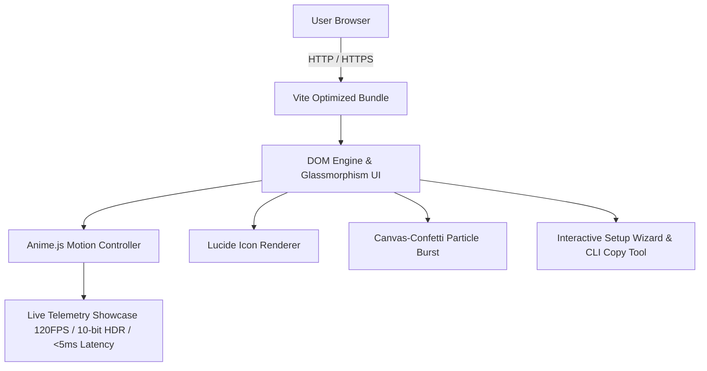

# 📱 AndroiDisplay Web — Interactive Showcase & Portal

[](https://vitejs.dev/)
[](https://developer.mozilla.org/en-US/docs/Web/JavaScript)
[](https://animejs.com/)
[](LICENSE)

An interactive, high-performance web landing page and technical documentation portal built for the **AndroiDisplay** ecosystem — a zero-lag 120 FPS 10-bit HEVC display extension bridge from macOS to Android devices.

---

## 🏗️ Architecture & Component Flow



---

## ✨ Key Features

- **⚡ Fluid Kinetic Motion:** Powered by Anime.js for spring physics, staggering card animations, and dynamic button micro-interactions.
- **🎨 Glassmorphism & Cyber Aesthetic:** Ultra-modern dark UI with dynamic backdrop filters, gradient borders, and typography.
- **📊 Real-Time Specs Simulator:** Live animated latency meter and throughput charts illustrating HEVC hardware stream performance.
- **📋 Interactive Quickstart & CLI Snippets:** One-click copy tools for macOS and Android setup commands.
- **🎉 Interactive Delight:** Canvas confetti triggers on completion milestones.
- **🚀 Sub-Millisecond Asset Load:** Built on Vite with tree-shaken Lucide icons and zero bloat.

---

## 📂 Project Structure

```
AndroiDisplay-Web/
├── index.html          # Semantic HTML5 entry layout & structured metadata
├── main.js             # Application lifecycle, animation timeline, & UI event listeners
├── style.css           # Glassmorphism design tokens, CSS variables, & responsive grid
├── vite.config.js      # Build optimization and local dev server config
├── package.json        # Dependencies (animejs, canvas-confetti, lucide)
└── .gitignore          # Build & node_modules exclusions
```

---

## 🚀 Quickstart & Installation

### Prerequisites
- **Node.js**: v18.0.0 or higher
- **npm** or **pnpm** or **yarn**

### Local Development

```bash
# 1. Clone the repository
git clone https://github.com/abhay2008/AndroiDisplay-Web.git
cd AndroiDisplay-Web

# 2. Install dependencies
npm install

# 3. Start local development server
npm run dev
```

The application will be running locally at `http://localhost:5173`.

### Production Build

```bash
# Build optimized static assets for deployment
npm run build

# Preview production build locally
npm run preview
```

---

## 🌐 Deployment

The output in `dist/` is completely static and can be deployed in seconds to **Vercel**, **Netlify**, or **GitHub Pages**:

```bash
# Deploy with Vercel CLI
npx vercel --prod
```

---

## 👨‍💻 Author

**Abhay Kashyap**
- GitHub: [@abhay2008](https://github.com/abhay2008)
- Parent Project: [AndroiDisplay](https://github.com/abhay2008/AndroiDisplay)
